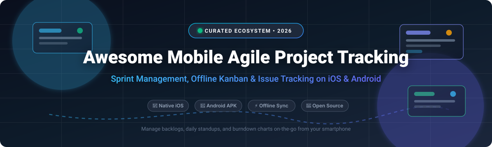

# 🚀 Awesome Mobile Agile Project Tracking 📱

**A curated index of top-tier SaaS platforms, self-hosted solutions, and open-source GitHub projects for mobile agile project management, sprint backlogs, issue tracking, and offline Kanban boards on iOS & Android.**

  
  
  
  
  
  
  

---

## 📖 Table of Contents

- [📌 Sector Overview & Market Dynamics](#-sector-overview--market-dynamics)
- [☁️ SaaS & Hosted Platforms](#️-saas--hosted-platforms)
- [💻 Open-Source GitHub Projects](#-open-source-github-projects)
- [🤝 How to Contribute](#-how-to-contribute)
- [💖 Support & Sponsorship](#-support--sponsorship)
- [⭐ Star History](#-star-history)
- [⚖️ Disclaimer](#️-disclaimer)

---

## 📌 Sector Overview & Market Dynamics

The global agile project management and issue tracking software sector is projected to reach approximately **$5.5B to $7.2B in 2026**, registering a steady compound annual growth rate (CAGR) of 13.2%. As distributed engineering teams embrace continuous mobile availability, mobile sprint triage and on-the-go standup reviews have transitioned from nice-to-have companion utilities to mission-critical workflows.

The competitive landscape is **moderately fragmented with significant enterprise concentration** at the upper echelon. Mega-cap ecosystem players—most notably Microsoft (GitHub Projects) and Atlassian (Jira, Trello)—dominate enterprise installations, while high-velocity challengers like Linear, monday.com, and ClickUp compete aggressively on mobile speed, fluid gesture control, and offline sync performance. In parallel, self-hostable open-source alternatives are rapidly maturing across Flutter and native Android stacks to deliver privacy-first agile workflows.

---

## ☁️ SaaS & Hosted Platforms

A comprehensive comparison of top commercial agile project tracking platforms offering native mobile applications on iOS and Android. Sorted by company valuation / annual recurring revenue (descending).

| 🏢 Platform | 💰 Company Valuation / Revenue | 🏷️ Pricing (Starting Tier) | 🎁 Free Tier Limits | 📱 Mobile Agile Capabilities |
| :--- | :--- | :--- | :--- | :--- |
| **[GitHub Mobile](https://github.com/)** | ~$3.1T *(Microsoft Parent Market Cap)* | $4/user/month *(Team tier billed monthly, or $3.67/mo billed annually)* | Free forever; unlimited public/private repos, 2,000 CI/CD mins/month, 500MB Packages storage, community support | ⚡ Native issue triage, mobile Projects (v2) Kanban board browsing, sprint iteration assignment, PR reviews, push notifications. |
| **[Jira Mobile](https://www.atlassian.com/software/jira)** | ~$45B+ *(Atlassian Market Cap, ~$4.4B FY24 ARR)* | $7.53/user/month *(Standard plan billed annually)* | Free forever up to 10 users; 2 GB file storage, Scrum and Kanban boards, backlog management, community support | 📋 Full native Jira sprint tracking, drag-and-drop Kanban, backlog grooming, real-time issue updates, push notifications. |
| **[Monday.com Mobile](https://monday.com/)** | ~$13B+ *(Market Cap, ~$950M+ ARR)* | $9/user/month *(Basic plan, 3-seat minimum = $27/month billed annually)* | Free forever up to 2 seats; 3 boards, 200+ templates, unlimited docs, 500MB storage | 📊 Mobile Work OS boards, agile sprint tracking, visual customizable status columns, and dashboard widgets. |
| **[ClickUp Mobile](https://clickup.com/)** | ~$4.0B *(Valuation, ~$200M+ ARR)* | $7/user/month *(Unlimited plan billed annually)* | Free forever for unlimited users; 100MB storage, 100 uses of custom fields, 100 uses of Gantt & Sprint points | 🎯 Native all-in-one mobile app for task management, sprint cycle views, checklists, and document collaboration. |
| **[Asana Mobile](https://asana.com/)** | ~$3.2B *(Market Cap, ~$700M+ ARR)* | $10.99/user/month *(Starter plan billed annually)* | Free forever up to 10 users; unlimited tasks and projects, list/board/calendar views, 100MB file attachments limit | 🗓️ Native task boards, sprint milestone tracking, timeline overviews, and mobile team collaboration. |
| **[Wrike Mobile](https://www.wrike.com/)** | ~$2.25B *(Acquired by STG / former Citrix valuation)* | $9.80/user/month *(Team plan billed annually)* | Free forever for unlimited users with basic task management, 2 GB total storage space, and limited active task limits | 📈 Mobile Gantt and Kanban boards, sprint task tracking, custom request forms, and offline work sync. |
| **[Linear Mobile](https://linear.app/)** | ~$1.25B *(Valuation, ~$30M+ ARR)* | $8/user/month *(Standard plan billed annually)* | Free forever up to 250 active issues; unlimited users, full export capability, 10MB file upload limit | ⚡ Lightning-fast native mobile client, cycle (sprint) tracking, offline support, triage inbox, keyboard-first feel on mobile. |
| **[Trello Mobile](https://trello.com/)** | Part of Atlassian *(~$45B Market Cap, acquired for $425M)* | $5/user/month *(Standard plan billed annually)* | Free forever for unlimited members; up to 10 workspace boards, unlimited Power-Ups, 10MB file attachments limit | 🗂️ Polished native mobile card and board manipulation, offline Kanban editing, labels, checklist tracking, and Power-Ups. |
| **[Shortcut Mobile](https://shortcut.com/)** | ~$500M *(Valuation / Series B funding)* | $8.50/user/month *(Team plan billed annually)* | Free forever up to 4 users; unlimited stories, unlimited epics, core docs, full API access | 🛠️ Native story cards, iteration/sprint boards, epic roadmaps, and developer-tailored workflows. |
| **[Basecamp Mobile](https://basecamp.com/)** | Bootstrapped / Private *(~$100M+ estimated annual revenue)* | $15/user/month *(Basecamp standard; or $299/month flat Basecamp Pro Unlimited)* | 30-day full-featured free trial with all features and no user caps; no permanent free tier | 🏕️ Hill charts for progress tracking, to-do lists, message boards, real-time campfire chats, and client-friendly portals. |

---

## 💻 Open-Source GitHub Projects

Explore open-source mobile agile frameworks, self-hosted backends with mobile apps, and native community clients. Sorted in descending order by GitHub_Stars.

| 📦 Repository | ⭐ GitHub_Stars | 🏗️ Architecture & Mobile Client | 📝 Description |
| :--- | :--- | :--- | :--- |
| **[AppFlowy](https://github.com/AppFlowy-IO/AppFlowy)** |  | Flutter / Rust (Android, iOS, Desktop) | Open-source Notion and Jira alternative with native mobile clients for iOS and Android, Kanban boards, and offline-first sync. |
| **[Focalboard](https://github.com/mattermost-community/focalboard)** |  | Go / React / Native (iOS/macOS) | Open-source self-hosted Trello/Asana alternative. *(Note: Standalone version unmaintained since June 2024; active within Mattermost Boards).* |
| **[WeKan](https://github.com/wekan/wekan)** |  | Node.js / Meteor (Mobile PWA & Native WeNa) | Collaborative open-source Kanban board with touch support for mobile browsers and offline SQLite client development. |
| **[OpenProject](https://github.com/opf/openproject)** |  | Ruby on Rails / Angular (Mobile Responsive Web) | Enterprise-grade open-source agile project management software featuring sprint backlogs, task boards, bug tracking, and mobile web views. |
| **[Planka](https://github.com/plankanban/planka)** |  | Node.js / React (Community Flutter Mobile Client) | Elegant open-source Kanban board for tracking sprint cards, tasks, user assignments, and timers with community mobile app support. |
| **[Leantime](https://github.com/Leantime/leantime)** |  | PHP / Vue.js (Android & iOS Companion App) | Open-source, ADHD-friendly agile system combining Kanban boards, milestones, sprint management, and native mobile focus apps. |
| **[Nextcloud Deck](https://github.com/nextcloud/deck)** |  | PHP / Nextcloud (Native Android Client Available) | Kanban-style task board integrated into Nextcloud, supporting sprint tags, attachments, and native Android syncing. |
| **[Vikunja Cross-Platform App](https://github.com/go-vikunja/app)** |  | Flutter (Android & iOS) | Official cross-platform mobile client for Vikunja supporting Kanban, sprint tasks, and checklists. *(Alpha pre-release).* |
| **[Nextcloud Deck Android](https://github.com/stefan-niedermann/nextcloud-deck)** |  | Kotlin / Android Native | Full-featured native Android app for Nextcloud Deck boards, with offline caching, card dragging, and instant board sync. |
| **[Plane Mobile](https://github.com/makeplane/plane-mobile)** |  | Flutter (Android & iOS) | Official mobile app for Plane (open-source Jira/Linear alternative), with Cycle sprint tracking, modules, and issue layouts. |
| **[Taiga Mobile](https://github.com/EugeneTheDev/TaigaMobile)** |  | Kotlin / Android Native | Native Android client for Taiga.io agile management, supporting sprint task boards, issue tracking, and user story transitions. |
| **[Planka Flutter App](https://github.com/LouisHDev/planka_app)** |  | Dart / Flutter (Android & iOS) | Unofficial open-source Flutter mobile client for Planka Kanban servers, offering on-the-go board and task updates. |
| **[Taiga Mobile Nova](https://github.com/Grigoriym/TaigaMobileNova)** |  | Jetpack Compose / Android | Modern open-source Android client for Taiga.io with sprint tracking, Kanban board manipulation, and wiki access. |
| **[Scrum Agile Studio](https://github.com/alfredang/scrum)** |  | HTML5 / JS / Mobile Web | Single-file mobile-friendly collaborative Scrum studio with planning poker, burndown charts, and touch sprint Kanban. |

---

## 🤝 How to Contribute

Contributions are warmly welcomed! Help keep this agile directory comprehensive and up to date:

1. 🍴 Fork the repository.
2. 🌿 Create a new feature branch (`git checkout -b feature/new-agile-tool`).
3. 📝 Add or update entries in `README.md` (ensure pricing, free tier limits, and links are accurate).
4. 🚀 Commit your changes (`git commit -m "Add NewTool to mobile agile directory"`).
5. 📤 Push to the branch (`git push origin feature/new-agile-tool`).
6. 📬 Submit a Pull Request describing your updates.

---

## 💖 Support & Sponsorship

If you find this curated list valuable for evaluating mobile sprint trackers, agile tools, or self-hosted backends, please consider showing your support:

- ⭐ **Star this repository** to boost visibility for the developer and agile community!
- 🍴 **Fork and share** it with your scrum teams, product owners, and agile engineering peers.
- ☕ **Buy a coffee & sponsor**: Support continued curation and open-source contributions directly on the [GitHub Sponsors Dashboard](https://github.com/sponsors/ishandutta2007).

Thank you for being part of the open-source community! 🙌

---

## ⭐ Star History

---

## ⚖️ Disclaimer

- This curated collection is maintained for informational and educational purposes only; inclusion does not constitute endorsement.
- Mobile agile tracking platforms handling sprint data, proprietary backlogs, and user telemetry must comply with internal organizational security policies.
- Self-hosted solutions require operators to maintain their own backup routines, SSL/TLS configurations, and secure mobile sync gateways.
- All product names, logos, and brands are property of their respective owners.

---

  <b>Built with ❤️ for Scrum Masters, Product Owners, and Agile Engineers worldwide.</b>

